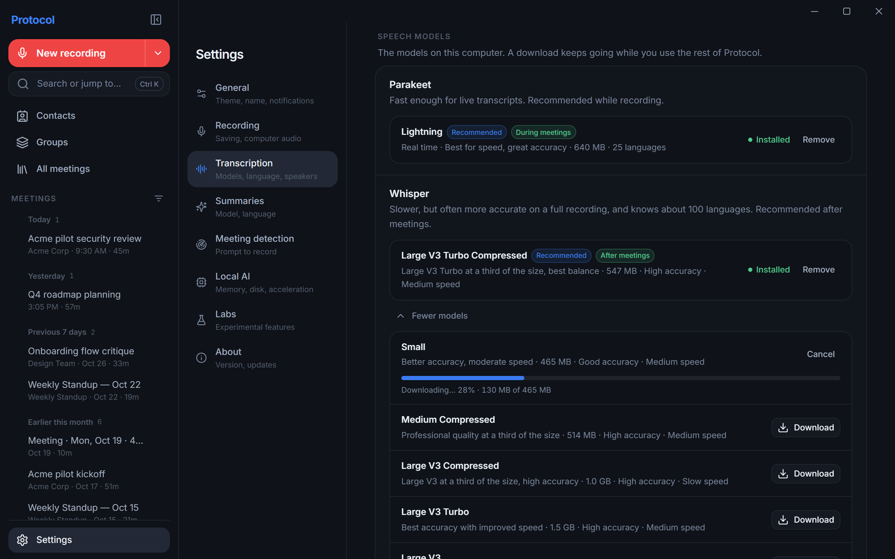
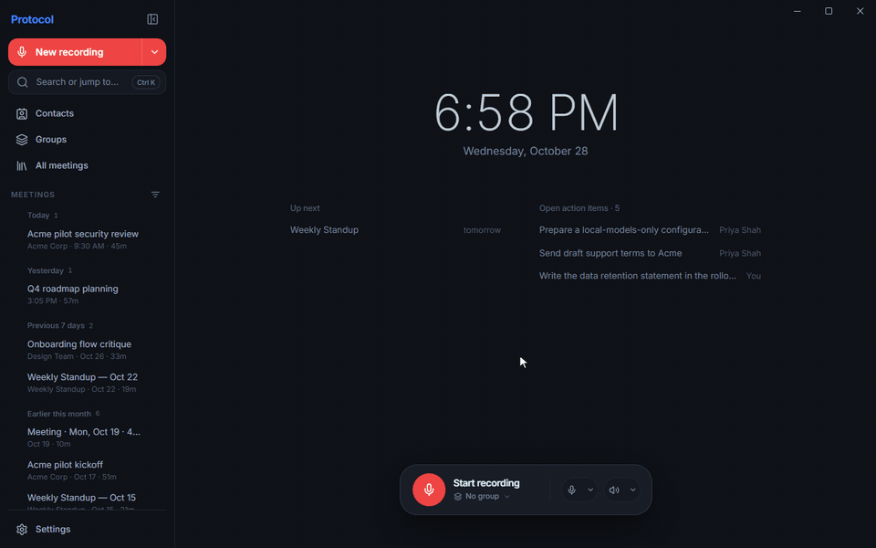
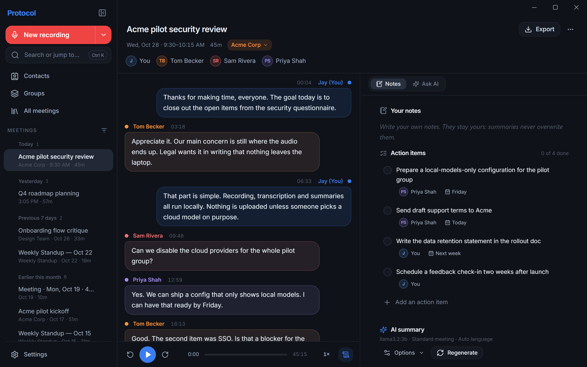
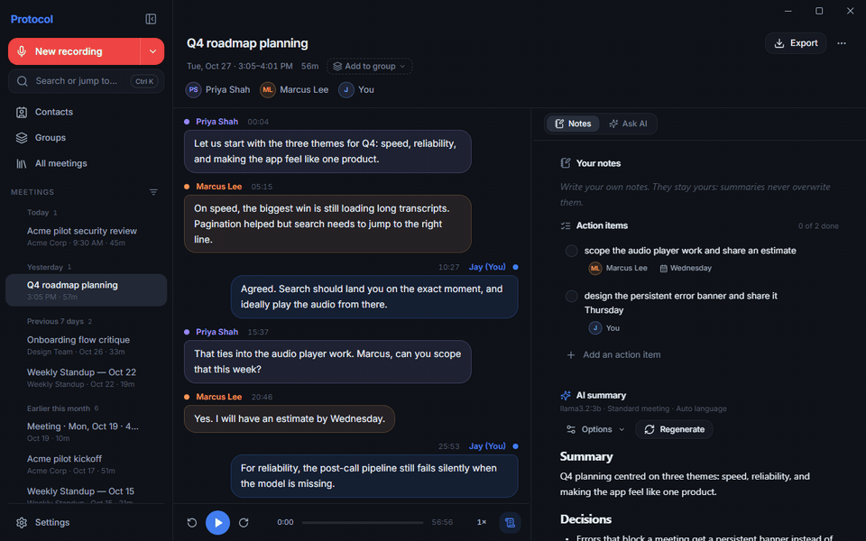

  

<h1 align="center">Protocol</h1>

  <strong>Meeting notes that never leave your computer.</strong> 
  Protocol records your calls, transcribes them on your machine, tells the
  speakers apart, and keeps notes, action items, and summaries next to the
  transcript.

  <a href="https://github.com/vmedvedevpro/Protocol/releases/latest"><strong>Download the latest release</strong></a>
  for Windows, macOS (Apple Silicon), or Linux (experimental)

Free and open source: no account, no subscription, no analytics. Protocol is
built on [Meetily – Actually Free](https://github.com/TylerBuza/Meetily-ActuallyFree),
which made the original [Meetily](https://github.com/Zackriya-Solutions/meetily)
free of paid tiers and added speaker diarization and voice profiles.

## What Protocol adds

Everything Meetily – Actually Free offers is here, plus:

- **Runs next to Meetily.** Its own name, `protocol.exe`, folders, and
  settings. Install it beside Meetily or Meetily – Actually Free and keep
  both: installing, updating, or removing Protocol leaves them running and
  their data untouched.
- **Updates you control.** One check a day, which you can turn off. An update
  downloads only when you click **Download**, its signature is verified, and it
  installs when you click **Restart and update** or quit the app, never during
  a recording or while a meeting is being processed.
- **Verified models.** Whisper, Parakeet, and the summary models come from a
  model list in this repository, so models are added and updated without an
  app release; the speaker models are pinned in each release. Downloads come
  from Hugging Face at a fixed commit, and every file is checked against its
  SHA-256 before Protocol loads it.

  

- **A lean, locked-down app.** No analytics code, no internal commands the app
  does not use, and no setting that starts an executable of your choice.
- **One small Windows installer.** About 118 MB. It picks the Vulkan GPU build
  (NVIDIA, AMD, Intel Arc) or the CPU build for your computer by itself.
- **Builds you can check.** Windows, macOS, and Linux builds come from public
  GitHub Actions runs, with `SHA256SUMS.txt` and build-provenance
  attestations.

## Features

- **Capture.** Microphone and computer audio are recorded as separate tracks
  plus a mixed track. On Windows you can capture only the apps you choose
  instead of all computer audio.
- **Transcription on your machine.** Live transcription with Parakeet, and
  optional Whisper for a more accurate pass after the call. Import existing
  audio files too.

  

- **Who said what.** Your microphone is always **You**; remote voices are told
  apart with Pyannote/WeSpeaker or the optional Nemotron model. Rename and
  merge speakers during or after a call, link them to contacts, and let
  Protocol suggest names it has heard before (voice profiles, beta).
- **Notes and summaries.** Notes, action items, and AI summaries with local
  models (built-in models or Ollama) or a provider you connect with your own
  key: Claude, OpenAI, Groq, OpenRouter, or any compatible endpoint. Ask
  questions about a meeting and use your own summary templates.

  

- **Your meeting library.** History, groups, contacts, a **Ctrl+K** command
  bar, and export to PDF, Word, Markdown (with YAML frontmatter), text, or
  JSON.

  

- **Labs.** Opt-in meeting detection and automatic recording, waveform
  scrubbing, clean transcripts, a Whisper silence guard, and Parakeet on the
  GPU through DirectML.

## Install

Download the file for your system from the
[latest release](https://github.com/vmedvedevpro/Protocol/releases/latest):
Windows 10/11 x64, macOS 14.2+ on Apple Silicon, or Linux x64 (experimental).
The release page also has the checksums and step-by-step install notes.

The builds are not code-signed yet, so your system warns you the first time.

- **Windows:** if SmartScreen says "Windows protected your PC", click
  **More info**, then **Run anyway**. Setup installs for your user only, with
  no administrator rights.
- **macOS:** if Gatekeeper cannot verify Protocol, click **Open Anyway** in
  **System Settings → Privacy & Security** once.
- **Linux** builds are experimental: they are built and started in CI but not
  yet tested with real meetings.

After that, Protocol offers new versions itself; see
[docs/AUTO_UPDATE.md](docs/AUTO_UPDATE.md) for how updates work.

## Privacy

Recordings, transcripts, and settings stay on your computer. Nothing is sent
anywhere unless you choose a cloud provider for summaries, which then
processes that content under its own terms. Once a day, unless you turn it
off, Protocol asks GitHub whether a newer release or model list exists and
Hugging Face whether the models you downloaded changed, and a list of models
asks Hugging Face for their download sizes; the requests carry nothing about
you or your meetings. Models, including the repair download of
the bundled speaker models, are downloaded from Hugging Face.
See [PRIVACY_POLICY.md](PRIVACY_POLICY.md).

<strong>Where your data lives</strong>

| Data | Windows location |
| --- | --- |
| Database, templates, models, file-backed settings | `<app folder>\data` (installed: `%LOCALAPPDATA%\vmedvedevpro\Protocol\data`; dev build: `target\debug\data`); `%APPDATA%\vmedvedevpro\Protocol` if that folder is not writable |
| Recording and onboarding preferences | `%APPDATA%\io.github.vmedvedevpro.protocol` |
| WebView storage | `%LOCALAPPDATA%\io.github.vmedvedevpro.protocol` |
| Downloaded update and `updater.log` | `%LOCALAPPDATA%\io.github.vmedvedevpro.protocol\updates` (update preferences: `updater.json` in `%APPDATA%\io.github.vmedvedevpro.protocol`) |
| Recordings | `Music\protocol-recordings` (change in **Settings → Recording**) |

On macOS the first row is `~/Library/Application Support/vmedvedevpro/Protocol` and
recordings default to `~/Movies/protocol-recordings`.

Found a bug or want something? [Open an issue](https://github.com/vmedvedevpro/Protocol/issues).

## For developers

Building from source, checks, releases, and syncing with upstream are in
[docs/BUILDING.md](docs/BUILDING.md). Start with [AGENTS.md](AGENTS.md),
[ARCHITECTURE.md](ARCHITECTURE.md), and the
[development map](docs/DEVELOPMENT_MAP.md) before changing code.

## Credits and license

Protocol is based on [Meetily – Actually Free](https://github.com/TylerBuza/Meetily-ActuallyFree)
by Tyler Buza and the original [Meetily](https://github.com/Zackriya-Solutions/meetily)
by Zackriya Solutions, with contributions from their communities.

MIT licensed; see [LICENSE.md](LICENSE.md). Upstream copyright notices are retained.
