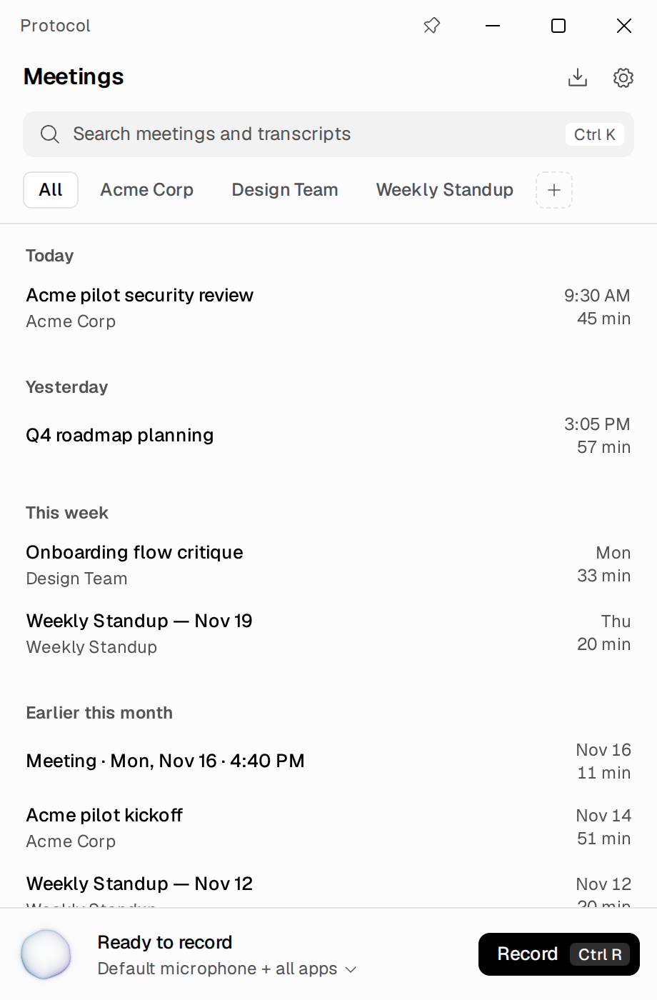
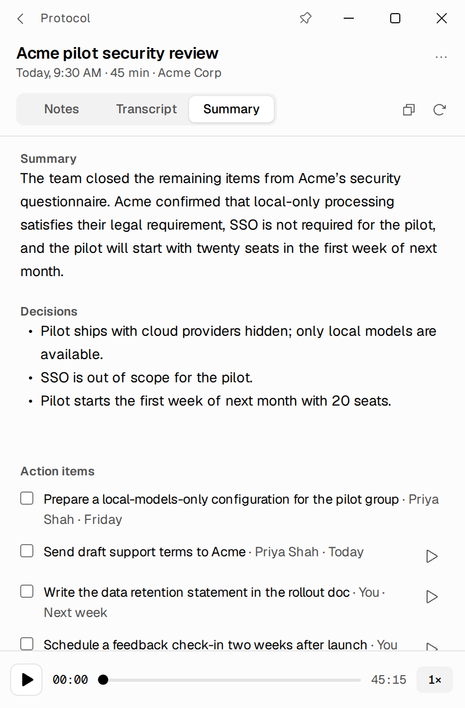
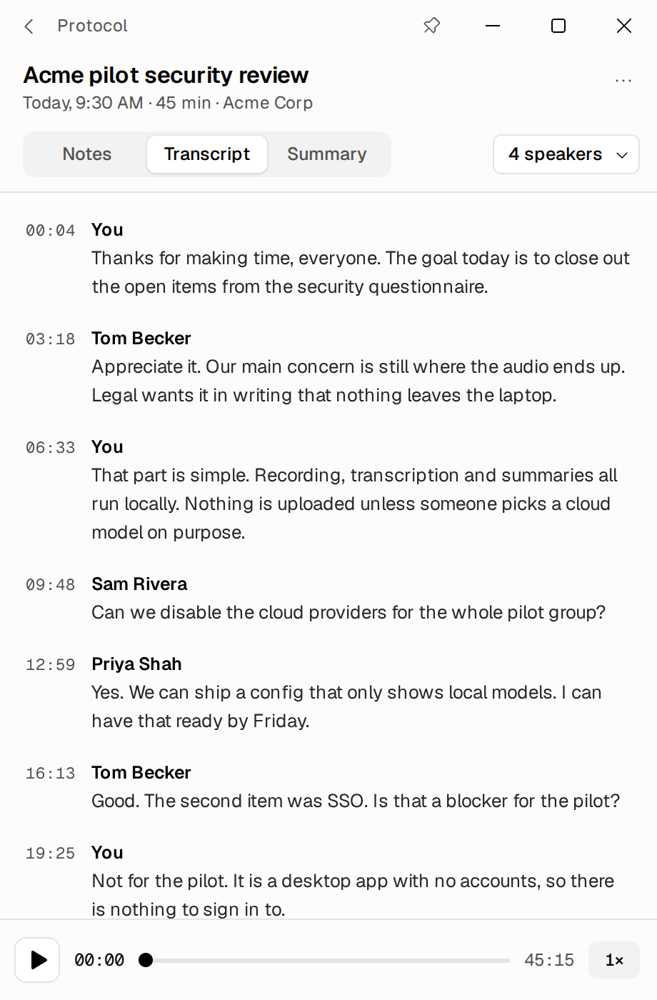
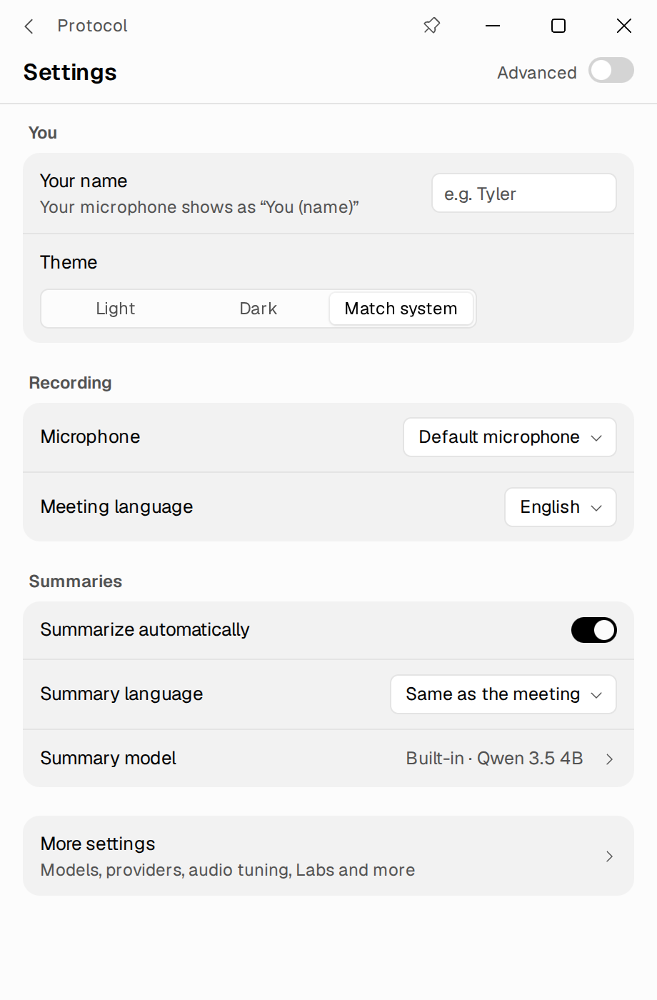

  <picture>
    <source media="(prefers-color-scheme: dark)" srcset="docs/media/ring-dark.gif">
    
  </picture>

<h1 align="center">Protocol</h1>

  <strong>Meeting notes that never leave your computer.</strong> 
  Protocol records your calls, transcribes them on your machine, tells the
  speakers apart, and writes the summary next to the transcript.

  <a href="https://github.com/vmedvedevpro/Protocol/releases/latest"><strong>Download the latest release</strong></a>
  for Windows, macOS (Apple Silicon), or Linux (experimental)

Free and open source: no account, no subscription, no analytics. Protocol is
built on [Meetily – Actually Free](https://github.com/TylerBuza/Meetily-ActuallyFree),
which made the original [Meetily](https://github.com/Zackriya-Solutions/meetily)
free of paid tiers and added speaker diarization and voice profiles.

## What Protocol does

Protocol is one small window that can sit beside your call. It follows your
system's light or dark mode, or keeps the one you pick.

### Record

Press **Record**. Microphone and computer audio are recorded as separate
tracks plus a mixed one; on Windows you can record only the apps you choose.
The ring shows what Protocol hears from each side. The transcript fills in
while you talk, with Parakeet on your machine. Notes you type during the
call join the transcript when you stop. Shrink the window to a floating bar
with the time and **Stop**.

  <picture>
    <source media="(prefers-color-scheme: dark)" srcset="docs/media/live-transcript-dark.gif">
    
  </picture>

### Your meetings

Home lists your meetings by date, with folders as chips above the list.
**Ctrl K** (**⌘K** on a Mac) searches everything: meetings, lines of a
transcript, summaries, people and settings. Open a line and the meeting
opens at that moment. The same search starts actions such as Record or
Import a recording, and you can drop an audio file anywhere in the window to
import it.

  <picture>
    <source media="(prefers-color-scheme: dark)" srcset="docs/media/home-dark.png">
    
  </picture>
  <picture>
    <source media="(prefers-color-scheme: dark)" srcset="docs/media/search-to-line-dark.gif">
    
  </picture>

### Who said what

Your microphone is always **You**. Remote voices are told apart with
Pyannote/WeSpeaker or the optional Nemotron model. Click a line to play it,
ask who said it, then rename or merge speakers. Each person has a page with
your meetings together, their open action items, and your private notes.
Protocol can suggest names it has heard before (voice profiles, in Labs).

### Summaries

After the call Protocol writes the summary: decisions, action items with
owners and due dates. It uses a built-in local model or Ollama, or a
provider you connect with your own key: Claude, OpenAI, Groq, OpenRouter, or
any compatible endpoint. Write it again with another template, language,
model or an instruction, and edit the templates. Improve the transcript with
Whisper for a more accurate pass. Export a meeting to PDF, Word, Markdown,
text, or JSON.

  <picture>
    <source media="(prefers-color-scheme: dark)" srcset="docs/media/meeting-summary-dark.png">
    
  </picture>
  <picture>
    <source media="(prefers-color-scheme: dark)" srcset="docs/media/meeting-transcript-dark.png">
    
  </picture>

### Settings, simple first

Settings shows the few choices most people need. Switch on **Advanced** for
transcription and speaker models, summary providers, templates, AI agents,
disk use and Labs. Settings has its own search.

  <picture>
    <source media="(prefers-color-scheme: dark)" srcset="docs/media/settings-dark.png">
    
  </picture>

## What Protocol adds

Protocol keeps what Meetily – Actually Free does and adds:

- **A new interface.** Written from scratch for 1.0: the compact window, the
  floating recording bar, search across everything, people pages, and
  settings that stay simple until you need more.
- **Faster transcription.** On a laptop with an Intel Core Ultra X7 358H,
  Whisper Large V3 Turbo Compressed on its Arc B390 GPU transcribes 20 minutes
  of a meeting after the call in about 2 minutes, where whisper.cpp 1.7.1 with
  the settings Protocol inherited took 10. On its processor, Parakeet
  transcribes about twice as fast as with the ONNX Runtime 1.22 setup Protocol
  inherited. Measured in [#64](https://github.com/vmedvedevpro/Protocol/pull/64),
  [#71](https://github.com/vmedvedevpro/Protocol/pull/71) and
  [#72](https://github.com/vmedvedevpro/Protocol/pull/72).
- **Runs next to Meetily.** Its own name, `protocol.exe`, folders, and
  settings. Install it beside Meetily or Meetily – Actually Free and keep
  both: installing, updating, or removing Protocol leaves them running and
  their data untouched.
- **Updates you control.** One check a day, which you can turn off. An update
  downloads only when you click **Download**, its signature is verified, and it
  installs when you click **Restart and update** or quit the app, never during
  a recording or while a meeting is being processed.
- **Verified models.** Whisper, Parakeet, and the summary models come from a
  model list in this repository, so models are added and updated without an
  app release; the speaker models are pinned in each release. Downloads come
  from Hugging Face at a fixed commit, and every file is checked against its
  SHA-256 before Protocol loads it. A download cut short can resume.
- **Your meetings in Claude.** Turn on AI agents in Settings › Advanced and
  Claude Desktop, Claude Code or another MCP client on your computer can
  search and read your meetings, read-only. See
  [the MCP server](docs/MCP_SERVER.md).
- **A lean, locked-down app.** No analytics code, no internal commands the app
  does not use, and no setting that starts an executable of your choice.
- **One Windows installer.** It picks the Vulkan GPU build (NVIDIA, AMD,
  Intel Arc) or the CPU build for your computer by itself.
- **Builds you can check.** Windows, macOS, and Linux builds come from public
  GitHub Actions runs, with `SHA256SUMS.txt` and build-provenance
  attestations.

## Install

Download the file for your system from the
[latest release](https://github.com/vmedvedevpro/Protocol/releases/latest):
Windows 10/11 x64, macOS 14.2+ on Apple Silicon, or Linux x64 (experimental).
The release page also has the checksums and step-by-step install notes.

The builds are not code-signed yet, so your system warns you the first time.

- **Windows:** if SmartScreen says "Windows protected your PC", click
  **More info**, then **Run anyway**. Setup installs for your user only, with
  no administrator rights.
- **macOS:** if Gatekeeper cannot verify Protocol, click **Open Anyway** in
  **System Settings → Privacy & Security** once.
- **Linux** builds are experimental: they are built and started in CI but not
  yet tested with real meetings.

After that, Protocol offers new versions itself; see
[docs/AUTO_UPDATE.md](docs/AUTO_UPDATE.md) for how updates work.

## Privacy

Recordings, transcripts, and settings stay on your computer. Nothing is sent
anywhere unless you choose a cloud provider for summaries, which then
processes that content under its own terms. Once a day, unless you turn it
off, Protocol asks GitHub whether a newer release or model list exists and
Hugging Face whether the models you downloaded changed, and a list of models
asks Hugging Face for their download sizes; the requests carry nothing about
you or your meetings. Models, including the repair download of
the bundled speaker models, are downloaded from Hugging Face.
See [PRIVACY_POLICY.md](PRIVACY_POLICY.md).

<strong>Where your data lives</strong>

| Data | Windows location |
| --- | --- |
| Database, templates, models, file-backed settings | `<app folder>\data` (installed: `%LOCALAPPDATA%\vmedvedevpro\Protocol\data`; dev build: `target\debug\data`); `%APPDATA%\vmedvedevpro\Protocol` if that folder is not writable |
| Recording and onboarding preferences | `%APPDATA%\io.github.vmedvedevpro.protocol` |
| WebView storage | `%LOCALAPPDATA%\io.github.vmedvedevpro.protocol` |
| Downloaded update and `updater.log` | `%LOCALAPPDATA%\io.github.vmedvedevpro.protocol\updates` (update preferences: `updater.json` in `%APPDATA%\io.github.vmedvedevpro.protocol`) |
| Recordings | `Music\protocol-recordings` (change in **Settings → Recording** with Advanced on) |

On macOS the first row is `~/Library/Application Support/vmedvedevpro/Protocol` and
recordings default to `~/Movies/protocol-recordings`.

Found a bug or want something? [Open an issue](https://github.com/vmedvedevpro/Protocol/issues).

## For developers

Building from source, checks, releases, and syncing with upstream are in
[docs/BUILDING.md](docs/BUILDING.md). Start with [AGENTS.md](AGENTS.md),
[ARCHITECTURE.md](ARCHITECTURE.md), and the
[development map](docs/DEVELOPMENT_MAP.md) before changing code.

## Credits and license

Protocol is based on [Meetily – Actually Free](https://github.com/TylerBuza/Meetily-ActuallyFree)
by Tyler Buza and the original [Meetily](https://github.com/Zackriya-Solutions/meetily)
by Zackriya Solutions, with contributions from their communities.

MIT licensed; see [LICENSE.md](LICENSE.md). Upstream copyright notices are retained.
